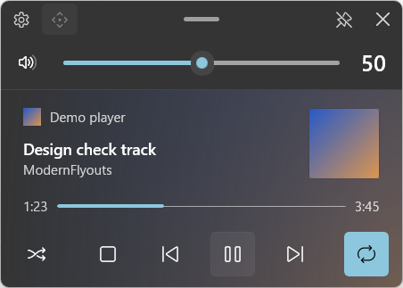
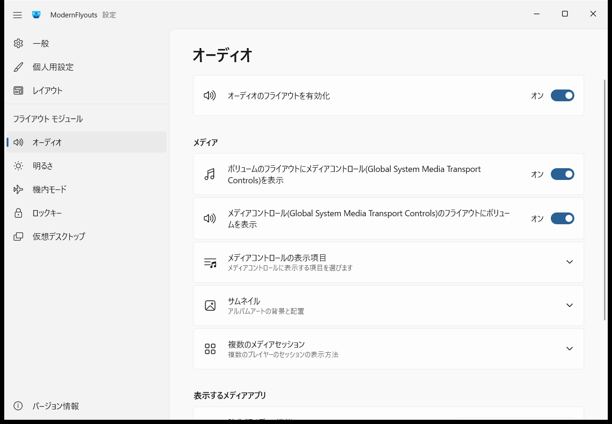

# ModernFlyouts（Luna Project 版）

[English](README.md) | **日本語**

Windows のフライアウト（音量、メディア、明るさなど）を、Fluent Design のモダンなものに置き換えるアプリです。
**WinUI 3** で作り直しています。

このリポジトリは [ModernFlyouts](https://github.com/ModernFlyouts-Community/ModernFlyouts) のフォークです。
保守が続けられている [usoppii 版](https://github.com/usoppii/ModernFlyouts)（0.10 系、.NET 10）に、
GlobalFlyouts（[Astear17](https://github.com/Astear17/GlobalFlyouts) / [Kinfani](https://github.com/Kinfani/GlobalFlyouts)）の
強化版メディア機能を統合し、アプリを WPF から WinUI 3 に移行しました。

<p>
  
</p>

## 主な機能

### フライアウト
- **音量**、**メディア**、**明るさ**（ディスプレイごとに表示）、**機内モード**、
  **ロックキー**（Caps Lock、Num Lock、Scroll Lock、Insert）、**仮想デスクトップ**
- アクリル背景（不透明度を調整可能）。テーマはライト、ダーク、または Windows モードに合わせる
- メディア
  - 普段はプログレスバーで、マウスを乗せるとシークバーに切り替わる（プレイヤーがシークに対応している場合）
  - シャッフルとリピートのボタン、アルバムアートの背景表示、複数セッションの横並び／縦並び表示
  - 強化版メディア機能: 表示するセッションの選択、プレイヤーの固定、アプリのフィルター、
    再生位置をまれにしか通知しないプレイヤーでの再生位置の補間
    （詳しくは [docs/enhanced-media-backend.md](docs/enhanced-media-backend.md)）
- 既定の出力デバイスの切り替え（イヤホンの接続など）に追従
- 表示位置: 9 か所から選ぶか、上部バーをドラッグして自由な位置に
- 上部バー: 常に表示、上端を指したときに表示、非表示

### 設定画面
- Windows の設定アプリと同じ構成（WinUI のタイトルバーとナビゲーション、CommunityToolkit の設定カード）
- 30 言語に対応
- 通知領域のアイコン（色付き／モノクロ）と、WinUI の右クリックメニュー
- Windows の起動時に実行

<p>
  
</p>

## 動作環境

- Windows 10 バージョン 2004（ビルド 19041）以降。Windows 11 向けに設計しています
- x64、x86、ARM64

## インストール

1. [Releases](../../releases) ページから `.msixbundle` と `LunaProject.cer` をダウンロードします。
2. 署名用の証明書を信頼済みにします（初回のみ）。**管理者として** PowerShell を開き、次を実行します。

   ```powershell
   Import-Certificate -FilePath .\LunaProject.cer -CertStoreLocation Cert:\LocalMachine\TrustedPeople
   ```

   または `LunaProject.cer` を開き、［証明書のインストール］→［ローカル コンピューター］→
   ［証明書をすべて次のストアに配置する］→［信頼されたユーザー］の順に選びます。
3. `.msixbundle` を開いて［インストール］を選びます。

設定画面は、通知領域のアイコンから、またはアプリをもう一度起動すると開きます。

## ビルド

必要なもの: .NET 10 SDK、Visual Studio 2026（MSBuild。Windows アプリケーション開発のワークロード）、Windows SDK

```powershell
# パッケージにしないデバッグビルド
dotnet build ModernFlyouts.WinUI\ModernFlyouts.WinUI.csproj -c Debug -p:Platform=x64
.\ModernFlyouts.WinUI\bin\x64\Debug\net10.0-windows10.0.26100.0\win-x64\ModernFlyouts.WinUI.exe

# 署名付き MSIX バンドル（x86、x64、ARM64）を AppPackages\WinUI に作成
.\tools\build-msix.ps1 -Thumbprint <コード署名証明書の拇印>
```

デバッグビルドでは、動作確認用に次のオプションを使えます:
`--settings`、`--settings-page <ページ>`、`--demo-media`、`--demo-media-noseek`、
`--demo-brightness`、`--demo-desktop`、`--demo-traymenu`

### プロジェクト構成

| プロジェクト | 内容 |
|---|---|
| `ModernFlyouts.WinUI` | WinUI 3 アプリ本体 |
| `ModernFlyouts.Core` | 共通の処理（メディアのバックエンド、ディスプレイ、Windows API の呼び出し）。UI フレームワークに依存しない |
| `ModernFlyouts.Core.Tests` | 単体テスト |

元の WPF アプリは、このリポジトリの履歴と
[ModernFlyouts](https://github.com/ModernFlyouts-Community/ModernFlyouts) にあります。

## クレジット

- [ModernFlyouts](https://github.com/ModernFlyouts-Community/ModernFlyouts)（Shankar、Sam と ModernFlyouts コミュニティ）
- [usoppii/ModernFlyouts](https://github.com/usoppii/ModernFlyouts)
- [Astear17/GlobalFlyouts](https://github.com/Astear17/GlobalFlyouts)、
  [Kinfani/GlobalFlyouts](https://github.com/Kinfani/GlobalFlyouts)
- [Windows Community Toolkit](https://github.com/CommunityToolkit/Windows)（設定カード）、
  [NAudio](https://github.com/naudio/NAudio)

## ライセンス

[MIT](LICENSE)
