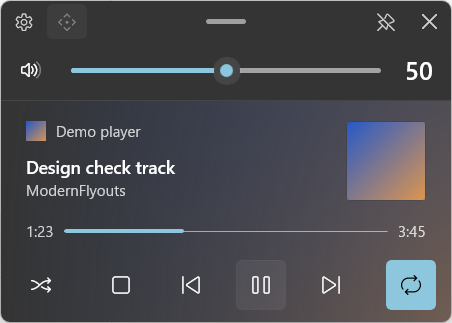
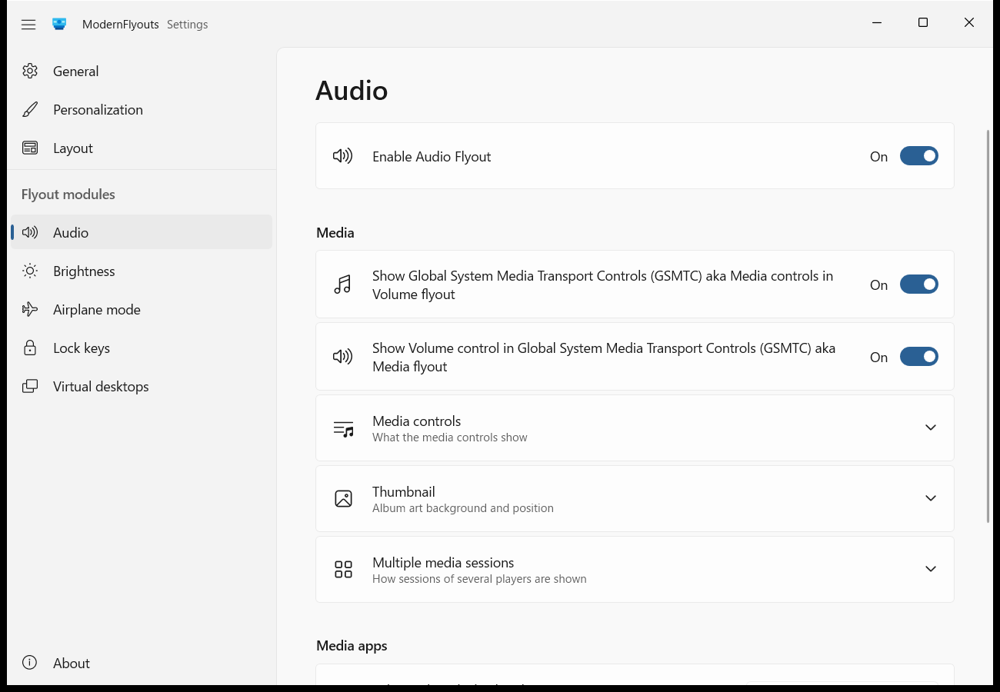

# ModernFlyouts (Luna Project build)

**English** | [日本語](README.ja.md)

A modern, Fluent Design replacement for the Windows flyouts (volume, media, brightness and
more), rebuilt with **WinUI 3**.

This repository is a fork of [ModernFlyouts](https://github.com/ModernFlyouts-Community/ModernFlyouts).
It combines the maintained [usoppii fork](https://github.com/usoppii/ModernFlyouts) (0.10 line,
.NET 10) with the enhanced media backend of GlobalFlyouts
([Astear17](https://github.com/Astear17/GlobalFlyouts) / [Kinfani](https://github.com/Kinfani/GlobalFlyouts)),
and moves the app from WPF to WinUI 3.

<p>
  
</p>

## Features

### Flyouts
- **Volume**, **media**, **brightness** (one row per display), **airplane mode**,
  **lock keys** (Caps Lock, Num Lock, Scroll Lock, Insert) and **virtual desktops**
- Acrylic background with adjustable opacity; light, dark, or following the Windows mode
- Media
  - Progress bar that turns into a seek bar when you point at it (when the player allows seeking)
  - Shuffle and repeat buttons, album art as background, several sessions side by side or stacked
  - Enhanced media backend: picks one session, can pin a player, filter apps and keeps the
    position moving for players that report it rarely (see
    [docs/enhanced-media-backend.md](docs/enhanced-media-backend.md))
- Follows the default audio device (e.g. when earbuds connect)
- Placement: one of 9 positions, or anywhere by dragging the top bar
- Top bar: always shown, shown when pointing at the top edge, or hidden

### Settings
- Windows Settings-style window (WinUI title bar and navigation, CommunityToolkit setting cards)
- 30 languages
- Notification area icon (colored or monochrome) with a WinUI context menu
- Run at startup

<p>
  
</p>

## Requirements

- Windows 10 version 2004 (build 19041) or later; designed for Windows 11
- x64, x86 or ARM64

## Installation

1. Download the `.msixbundle` and `LunaProject.cer` from the [Releases](../../releases) page.
2. Trust the signing certificate (once). In PowerShell **as administrator**:

   ```powershell
   Import-Certificate -FilePath .\LunaProject.cer -CertStoreLocation Cert:\LocalMachine\TrustedPeople
   ```

   Or open `LunaProject.cer` → **Install Certificate** → **Local Machine** →
   **Place all certificates in the following store** → **Trusted People**.
3. Open the `.msixbundle` and select **Install**.

The settings open from the notification area icon or by starting the app again.

## Building

Requirements: .NET 10 SDK, Visual Studio 2026 (MSBuild) with Windows application development,
Windows SDK.

```powershell
# Unpackaged debug build
dotnet build ModernFlyouts.WinUI\ModernFlyouts.WinUI.csproj -c Debug -p:Platform=x64
.\ModernFlyouts.WinUI\bin\x64\Debug\net10.0-windows10.0.26100.0\win-x64\ModernFlyouts.WinUI.exe

# Signed MSIX bundle (x86, x64, ARM64) into AppPackages\WinUI
.\tools\build-msix.ps1 -Thumbprint <your code signing certificate thumbprint>
```

Debug builds accept a few options for trying things out: `--settings`, `--settings-page <page>`,
`--demo-media`, `--demo-media-noseek`, `--demo-brightness`, `--demo-desktop`, `--demo-traymenu`.

### Projects

| Project | |
|---|---|
| `ModernFlyouts.WinUI` | The WinUI 3 app |
| `ModernFlyouts.Core` | Shared logic (media backends, displays, interop), UI-framework independent |
| `ModernFlyouts.Core.Tests` | Unit tests |
| `ModernFlyouts` | The original WPF app (kept for reference) |

## Credits

- [ModernFlyouts](https://github.com/ModernFlyouts-Community/ModernFlyouts) by Shankar, Sam and
  the ModernFlyouts community
- [usoppii/ModernFlyouts](https://github.com/usoppii/ModernFlyouts)
- [Astear17/GlobalFlyouts](https://github.com/Astear17/GlobalFlyouts) and
  [Kinfani/GlobalFlyouts](https://github.com/Kinfani/GlobalFlyouts)
- [Windows Community Toolkit](https://github.com/CommunityToolkit/Windows) (setting cards),
  [NAudio](https://github.com/naudio/NAudio)

## License

[MIT](LICENSE)
